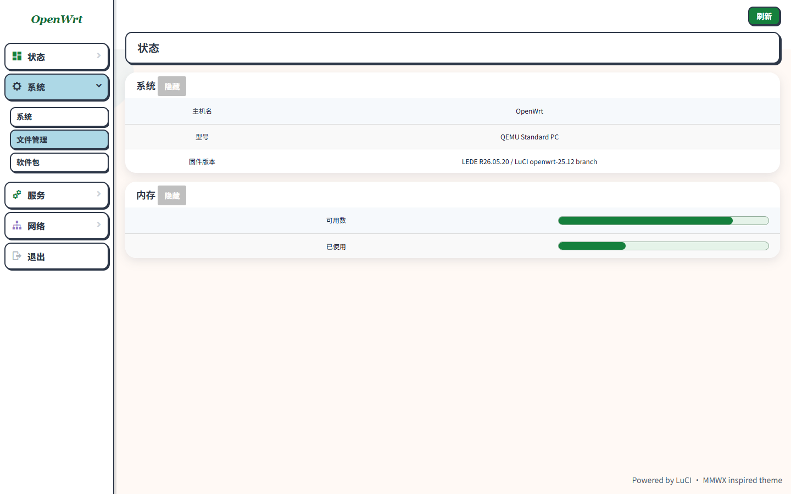

# MMWX 风格 LuCI 主题

为 **LEDE R26.05.20 / LuCI `openwrt-25.12`** 制作的非官方主题。后台页面以用户路由器当前的 **ArgonTheme v2.4.3** 为布局和交互基准：顶部横栏、左侧菜单、内容卡片、表单、页签、按钮位置和菜单展开动画沿用实际页面结构；颜色、描边、阴影和字体换成 [妙妙屋 X](https://mmwx.wyattu.net/) 的视觉语言。

## 预览



- `preview.html`：后台静态预览，包含文件管理、系统表单和进度条。
- `preview-login.html`：登录页静态预览。

静态预览不连接路由器，按钮不会执行系统操作。实际菜单和页面内容由 LuCI 与已安装插件生成。

## 在路由器上安装

先记录当前主题路径：

```sh
uci -q get luci.main.mediaurlbase
```

把整个目录复制到路由器，例如 `/tmp/luci-theme-mmwx`，以 root 执行：

```sh
cd /tmp/luci-theme-mmwx
sh install-router.sh
```

刷新 LuCI 后查看。恢复原主题时，把下面的路径换成安装前记录的值：

```sh
uci set luci.main.mediaurlbase='/luci-static/原主题目录名'
uci commit luci
```

## 编入固件

从 LEDE / OpenWrt 固件源码根目录运行（确保已更新并安装 LuCI feed，存在 `feeds/luci/luci.mk`）：

```sh
git clone --depth 1 --branch main https://github.com/Wyatt323/luci-theme-mmwx.git package/luci-theme-mmwx
./scripts/config --enable PACKAGE_luci-theme-mmwx
make defconfig
```

确认 `.config` 中是 `CONFIG_PACKAGE_luci-theme-mmwx=y` 后，按固件项目原有流程编译。软件包会注册主题；如需固件首次启动就默认使用 MMWX，再运行：

```sh
mkdir -p files/etc/uci-defaults
cp package/luci-theme-mmwx/examples/99-mmwx-default files/etc/uci-defaults/99-mmwx-default
chmod 0755 files/etc/uci-defaults/99-mmwx-default
```

GitHub Actions 接入、更新旧版与验证步骤见 [BUILD.md](BUILD.md)。

## 实现与来源

- 后台基础样式 `htdocs/luci-static/mmwx/css/cascade.css` 和菜单脚本 `htdocs/luci-static/resources/menu-mmwx.js` 取自用户路由器当前的 ArgonTheme v2.4.3 静态资源，保留页面布局和组件规则；子菜单点击处理与动画已针对快速连续点击优化。对应上游：[jerrykuku/luci-theme-argon](https://github.com/jerrykuku/luci-theme-argon/tree/v2.4.3)，Apache-2.0。
- 后台外观覆盖集中在 `htdocs/luci-static/mmwx/mmwx.css`。文件管理沿用路由器现有 `fileassistant` 插件的真实上传控件；选择文件和执行上传常驻显示，窄屏文件名与元数据分行。
- LuCI 和插件的横向页签统一使用描边胶囊样式，当前项为浅蓝色；OpenClash 的专用页签规则也已同步覆盖。窄屏可在页签栏内横向滚动。
- 侧栏一级菜单及内部菜单都使用白底描边、浅蓝选中态；一级菜单之间增加留白，内部菜单继续保持原有层级和滑动展开方式。长菜单在窄屏侧栏内可滚动。
- 登录页继续使用 LuCI `openwrt-25.12` 的 Bootstrap 基础样式与 `mmwx-login.css`。模板保留该分支的 ucode 接口。
- MMWX 提供视觉参考，本项目没有复制其图片或前端代码。
- 已在静态预览检查 1440、1024、717、390 和 320 px 宽度，检查原生文件输入框、上传区及登录页。`header.ut` 已修正会导致 LuCI 模板编译失败的 `` 语法；本地环境没有 ucode 编译器，打包前会检查该错误写法未再次出现。

## 许可证

本主题采用 Apache-2.0。LuCI 和 Argon 的原始版权信息保留在相应来源文件中。本主题与妙妙屋 X、Argon 和 OpenWrt 官方均无隶属关系。
